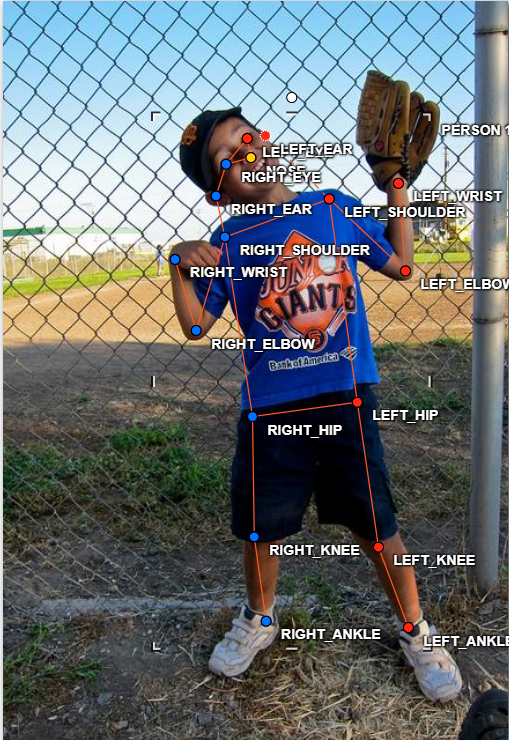
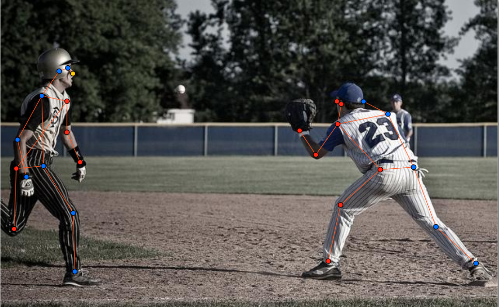
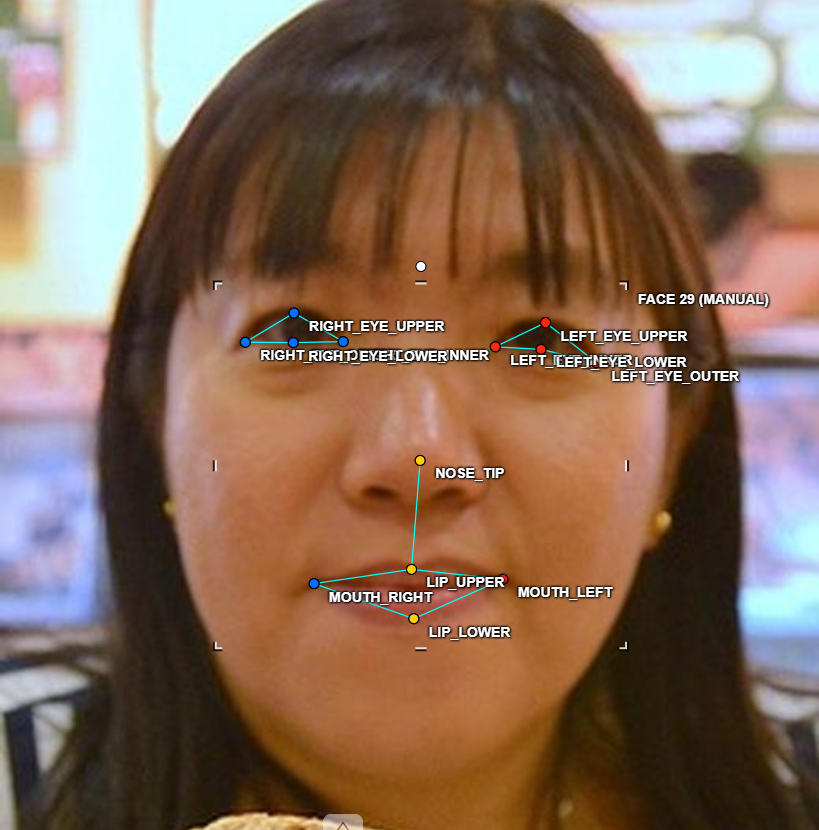
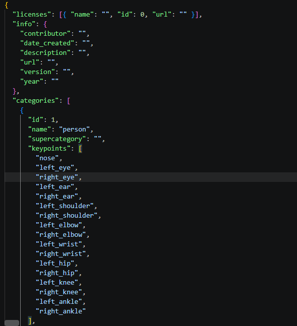

Dữ liệu: 12 ảnh người COCO val2017 (Lin et al., 2014) và 8 ảnh chân dung Wikimedia Commons, chỉ dùng trong lớp.

## 0. Thông tin học viên

- Họ tên:Pham Thanh Tung 
- MSSV:03519      
- Email:tungpham1824@gmail.com
- Link repository:https://github.com/tungpham1824/K5-L2-Day04-PhamThanhTung-03519-KeypointPose-Student.git
- Phiên bản CVAT (Help → About):2.74.1
- Máy: hệ điều hành _Window__ · RAM _16__ GB · chạy CVAT chế độ đầy đủ / lite
- Bộ ảnh (`src/exports/assignment.json` do `lab.py setup` tạo): có 
- Giờ bắt đầu:17h45  
- Giờ kết thúc:19h10

## 1. Kiểm tra label (CP0)

| Label | Kiểu | Số điểm | Tên điểm đúng bảng của lab? | Đúng thứ tự? | Số cạnh |
|---|---|---:|---|---|---:|
| `person` |Skeleton	 |17 |Có | 	Có|19 |
| `face` | 	Skeleton  |13 |Có | Có| |

Mẫu `person` dựng theo người quay mặt về camera (các điểm `left_*` nằm bên phải khung mẫu)? Có 

Cách đổi cờ `occluded` / `outside` cho **một điểm** trên phiên bản CVAT này (một câu):
Mở rộng skeleton trong danh sách object ở thanh bên phải, ở dòng của điểm cần đổi bấm biểu tượng occluded (hoặc outside), khi đó chỉ điểm đó đổi kiểu hiển thị, các điểm còn lại giữ nguyên.

## 2. Số lượng đã gán và thời gian (CP1, CP2)

| Nhóm ảnh | Số ảnh | Số skeleton đã gán | Số người dưới 60 px (không gán) | Số poster / gương / màn hình bỏ qua | Thời gian (phút) |
|---|---:|---:|---:|---:|---:|
| `easy` | 5 | 5| | | |
| `occluded` | 3 | 6| | | |
| `back` | 2 | 4| | | |
| `small` | 1 | 2| | | |
| `crowd` | 1 |3 | | | |
| `faces` | 8 |8 | — | | |

- Số ảnh người đã xong ở mốc phút 105: 10 / 10
- Thời gian thực tế (phút): CP1 90 · CP2 170 · CP3 190
- Ảnh tốn thời gian nhất là ảnh nào, vì sao?  ảnh 000000123544.jpg vì vừa có người quay lưng và người nghiêng

...

## 3. Bảng ca khó (CP1, CP2)

Mỗi điểm bạn phân vân một dòng, nhất là phân vân giữa `v = 1` và `v = 0`, hoặc không chắc hướng người.

| Ảnh | Người / mặt | Điểm | Cờ đã chọn | Phân vân giữa | Lý do chọn |
|---|---|---|---:|---|---|
|000000027565.jpg |Người 1 |left_ear |1 |v = 1 / v = 0 |Bị che nhưng đoán được vị trí khớp, nên chọn v = 1 thay vì v = 0. |
|000000091637.jpg |Người 1 |right_hip |1 |v = 1 / v = 0|Bị che nhưng đoán được vị trí khớp, nên chọn v = 1 thay vì v = 0. |
|000000175703.jpg | Người 1| right_shoulder, right_wrist, right_hip|1 |v = 1 / v = 0 |Bị che nhưng đoán được vị trí khớp, nên chọn v = 1 thay vì v = 0. |

## 4. Bảng tự review (CP3)

Đi từ ảnh cuối về ảnh đầu. 5 ảnh người (ít nhất 2 ảnh `back` hoặc `crowd`) và 3 ảnh mặt. Ít nhất 8 dòng, kể cả dòng `ok`. Ghi lỗi trước, sửa sau.

Mã lỗi dùng đúng một trong: `lr_swap`, `vis_flag`, `position`, `missing`, `extra`, `ok`.

| Ảnh | Người / mặt | Điểm | Mã lỗi | Ghi chú | Đã sửa? |
|---|---|---|---|---|---|
|000000461002.jpg (back) |Người 2 |cặp hip, knee, ankle |ok | |Không cần |
|000000150192.jpg (small) |Người 2 |cả skeleton |ok | |Không cần |
| | | | | | |
| | | | | | |
| | | | | | |
| | | | | | |
| | | | | | |
| | | | | | |

Tổng hợp số lỗi theo mã:

| `lr_swap` | `vis_flag` | `position` | `missing` | `extra` | `ok` |
|---:|---:|---:|---:|---:|---:|
| | | | | | |

Điểm còn phân vân giữa `v = 1` và `v = 0` (ghi cả hai lựa chọn và lý do chọn):

...

## 5. Kiểm file xuất và kết quả tự kiểm (CP4)

Tự kiểm tay trong file JSON:

| File | Người / mặt kiểm (ảnh, thứ tự) | Số phần tử `keypoints` | Điểm `outside` ra `v = 0`, `occluded` ra `v = 1`? | `num_keypoints` khớp? |
|---|---|---:|---|---|
| PhamThanhTung_persons.zip |Người 1 (annotation đầu tiên, image_id 1) |51 |Có: 1 điểm v = 1, còn lại v = 2 |Có (17 = 17) |
| PhamThanhTung_persons.zip |Người 2 (annotation thứ hai, image_id 2) |51 |Có: 1 điểm v = 1, 3 điểm v = 0, còn lại v = 2 |Có (14 = 14) |
| PhamThanhTung_faces.zip |Mặt 1 (annotation đầu tiên) |39 |Mặt này không có điểm occluded / outside, cả 13 điểm v = 2 |Có (13 = 13) |

Sau khi xuất, CVAT ghi `occluded` thành `v = 1` và `outside` thành `v = 0`. Tọa độ của điểm `outside` trong file là tọa độ cũ

Hai job đã chuyển sang completed trên CVAT? Có 

Dán phần **TÓM TẮT** in ra từ `src/check_submission.py`:

=== PhamThanhTung_persons.zip (label `person`) ===
  [CẢNH BÁO] 000000123544.jpg #1: cặp hip, knee nằm ngược phía so với các cặp còn lại. Có thể đổi trái/phải một cặp (`lr_swap`), hoặc tay / chân bắt chéo thật: kiểm lại.
  [CẢNH BÁO] 000000130816.jpg #3: các điểm chỉ trải cao 55 px (< 60 px). Người dưới 60 px không gán; nếu người cao hơn nhưng bị cắt khung thì bỏ qua cảnh báo này.
  [CẢNH BÁO] 000000150192.jpg #2: các điểm chỉ trải cao 59 px (< 60 px). Người dưới 60 px không gán; nếu người cao hơn nhưng bị cắt khung thì bỏ qua cảnh báo này.
  [CẢNH BÁO] 000000461002.jpg #2: cặp hip, knee, ankle nằm ngược phía so với các cặp còn lại. Có thể đổi trái/phải một cặp (`lr_swap`), hoặc tay / chân bắt chéo thật: kiểm lại.

=== PhamThanhTung_faces.zip (label `face`) ===

----- TÓM TẮT (dán vào báo cáo mục 5) -----
- File person: PhamThanhTung_persons.zip
  Số ảnh: 12 · số skeleton `person`: 20 · mỗi annotation 51 số
  Skeleton theo ảnh: 000000027565=1, 000000091637=2, 000000123544=2, 000000130816=3, 000000150192=2, 000000175703=1, 000000189365=2, 000000294329=1, 000000294379=1, 000000393909=2, 000000461002=2, 000000493741=1
  Cờ v: v=2 239 (70%) · v=1 13 (4%) · v=0 88 (26%)
  num_keypoints trung bình: 12.6
- File face: PhamThanhTung_faces.zip
  Số ảnh: 8 · số skeleton `face`: 8 · mỗi annotation 39 số
  Skeleton theo ảnh: face_10579=1, face_125051=1, face_204787=1, face_301643=1, face_415073=1, face_41666=1, face_476363=1, face_81239=1
  Cờ v: v=2 92 (88%) · v=1 0 (0%) · v=0 12 (12%)
  num_keypoints trung bình: 11.5
- Ghi chú: 100 điểm v = 0 vẫn mang tọa độ cũ (CVAT 2.x xuất như vậy; chuẩn COCO ghi 0, 0). Không phải lỗi: điểm v = 0 bị bỏ qua khi huấn luyện và khi chấm.
- Số [LỖI]: 0 · số [CẢNH BÁO]: 4
Kết quả: ĐẠT (đọc lại từng cảnh báo ở trên)

Các `[CẢNH BÁO]` còn giữ nguyên và lý do:
000000123544.jpg #1 và 000000461002.jpg #2 (cặp hip / knee / ankle nằm ngược phía): đã kiểm lại xác nhận nhãn không sai nên giữ nguyên.

## 6. Ảnh chụp màn hình

1. Label `person` trong label constructor (đủ 17 điểm có tên):

   

2. Một người quay lưng đã gán, cờ đã đặt:

   

3. Một khuôn mặt đã gán 13 điểm, phóng to vùng mắt:

   

4. Một đoạn JSON xuất của một người:

   

Nguồn ảnh: COCO val2017 / Wikimedia Commons.

## 7. Tự đánh giá

1. Lỗi bạn mắc nhiều nhất hôm nay, và cách bạn sẽ tránh ở dự án thật:

   Lỗi mình mắc nhiều nhất là cờ visibility v, chủ yếu ở các ảnh có người bị che. Ban đầu mình hay đặt v = 2 hoặc v = 1 cho điểm bị che mà thực ra không ước lượng được vị trí. Ở dự án thật mình sẽ tự hỏi trước mỗi điểm bị che: "mình có đoán chắc khớp nằm ở đâu không?". Đoán chắc thì v = 1, không đoán được thì v = 0, không đặt tạm cho có

2. Một quy tắc bạn đề xuất thêm vào guideline (kèm ảnh ví dụ nếu có):

   ...

3. Nhãn của bạn đi vào model ở đâu? Chọn một lỗi bạn đã sửa và nói nó sẽ làm model học sai thế nào (heatmap, trọng số trong loss, hay bước lật ảnh):

  Mỗi điểm v > 0 trở thành một đỉnh heatmap mà model phải học, còn điểm v = 0 bị loại khỏi loss. Lỗi cờ mình đã sửa là điểm bị che nhưng không đoán được vị trí mà vẫn để v > 0. Điểm đó là chỗ đoán bừa nhưng vẫn được tính vào loss, nên model bị dạy đặt đỉnh heatmap vào một vị trí không có căn cứ trên ảnh. Điểm đúng phải là v = 0 để model bỏ qua.

## 8. Khó khăn và lỗi kỹ thuật

...

## Bonus (nếu làm)

### B1 — 3 ảnh người khó thêm

| Ảnh | Số skeleton | Số người dưới 60 px | Ca khó nhất |
|---|---:|---:|---|
|000000074156.jpg |3 | |Người 2: chỉ thấy 9 điểm, 8 điểm v = 0 |
|000000125998.jpg |3 | | Người 3: chỉ thấy 4 điểm, 13 điểm v = 0|
| | | | |

Kết quả `src/check_submission.py` cho `HoVaTen_bonus_persons.zip`:

=== PhamThanhTung_bonus_persons.zip (label `person`) ===
  [CẢNH BÁO] 000000074156.jpg #1: trái/phải không nhất quán giữa các cặp điểm (eye, hip so với knee, ankle). Kiểm `lr_swap`.
  [CẢNH BÁO] 000000074156.jpg #2: các điểm chỉ trải cao 57 px (< 60 px). Người dưới 60 px không gán; nếu người cao hơn nhưng bị cắt khung thì bỏ qua cảnh báo này.
  [CẢNH BÁO] 000000517702.jpg #2: cặp shoulder, hip nằm ngược phía so với các cặp còn lại. Có thể đổi trái/phải một cặp (`lr_swap`), hoặc tay / chân bắt chéo thật: kiểm lại.
  [CẢNH BÁO] File có 3 ảnh, bài giao 12 ảnh. Xuất đúng task chưa?
=== PhamThanhTung_bonus_faces.zip (label `face`) ===
  [CẢNH BÁO] File có 5 ảnh, bài giao 8 ảnh. Xuất đúng task chưa?

- File person: PhamThanhTung_bonus_persons.zip
  Số ảnh: 3 · số skeleton `person`: 8
  Skeleton theo ảnh: 000000074156=3, 000000125998=3, 000000517702=2
  Cờ v: v=2 63 (46%) · v=1 6 (4%) · v=0 67 (49%)
- File face: PhamThanhTung_bonus_faces.zip
  Số ảnh: 5 · số skeleton `face`: 5
  Cờ v: v=2 57 (88%) · v=1 8 (12%) · v=0 0 (0%)
- Số [LỖI]: 0 · số [CẢNH BÁO]: 5
Kết quả: ĐẠT

### B2 — 5 ảnh khuôn mặt đen trắng / hồng ngoại

Ảnh không màu khó hơn ở điểm nào? Kính râm trên ảnh hồng ngoại có còn là `v = 1` không?

Hai ảnh (face_300200, face_68290) có đúng 4 điểm v = 1: người trong ảnh có râu che vùng miệng, nên mình chỉ ước lượng vị trí môi và khóe miệng và đặt occluded (v = 1), vì đoán được chỗ nhưng không thấy rõ mép môi. Ảnh không màu làm việc này khó hơn vì không có màu môi để phân biệt môi với râu và da xung quanh.

không có ảnh kính râm

### B3 — Model so với nhãn của tôi (không tính điểm)

- Demo đã dùng:
- Ảnh đã thử:

1. Model có trả điểm cho khớp bị che, hay khớp ngoài ảnh không? Confidence ở các điểm đó thế nào?

   ...

2. Với người quay lưng, model có đổi trái/phải không?

   ...

3. Bộ điểm của model có giống 17 điểm COCO không?

   ...

## 9. Tài liệu tham khảo và công cụ AI đã dùng

...
